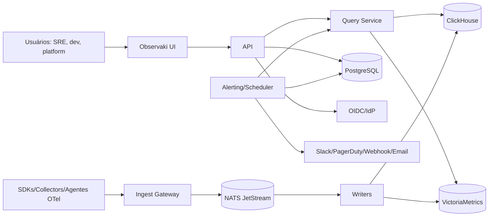
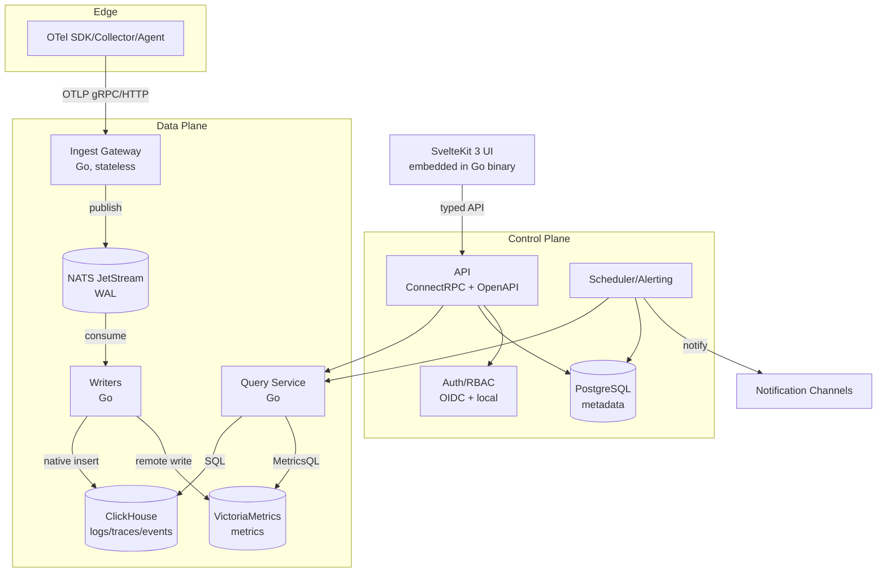
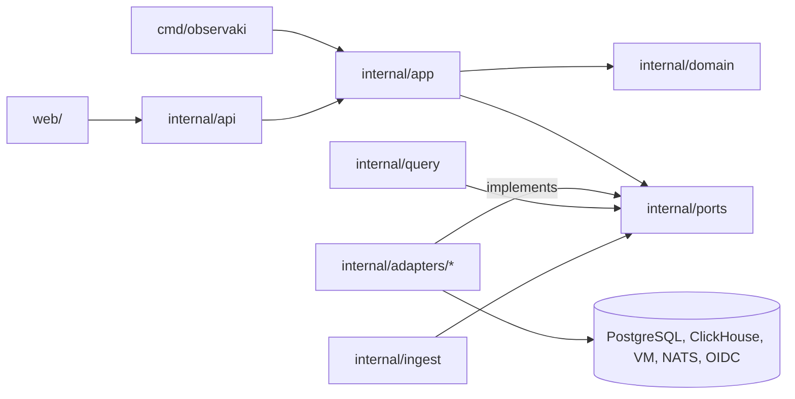
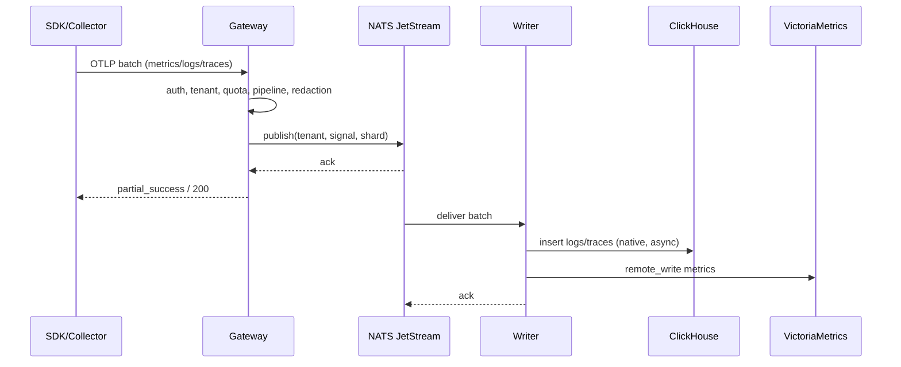
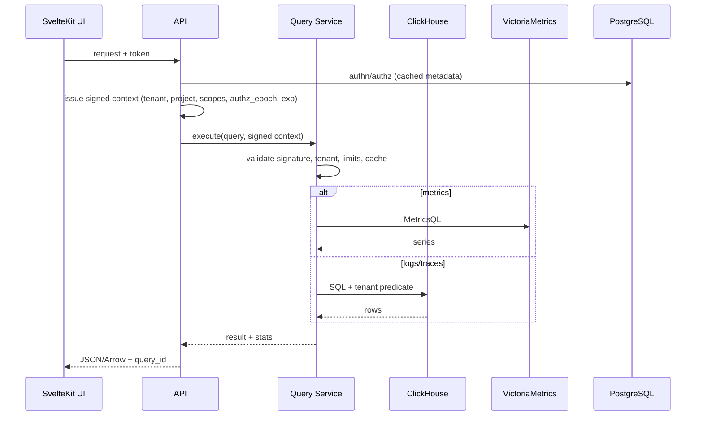
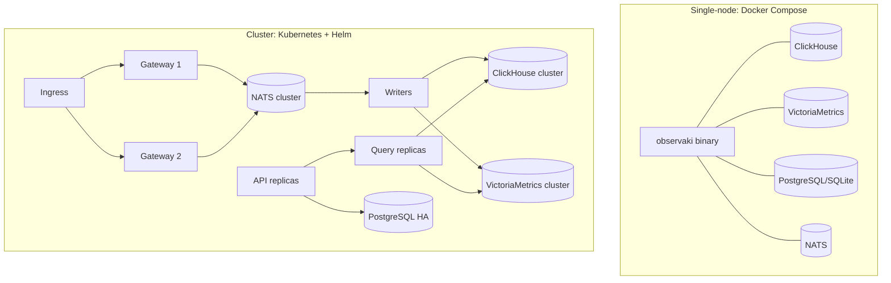
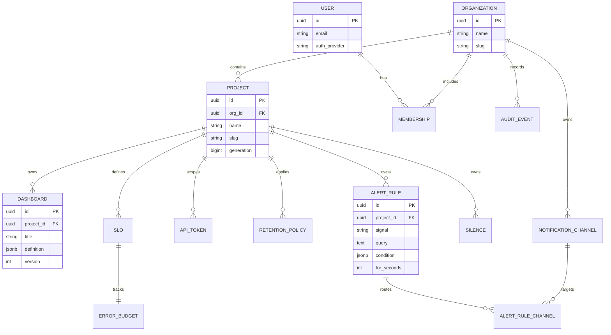

# Architecture Spine — Observaki

## Design Paradigm

**Ports & Adapters (hexagonal)** para o control plane e **pipes-and-filters** para o data plane. O control plane (API, auth, dashboards, alertas, metadados) é um monólito modular com domínio isolado e adaptadores para PostgreSQL, OIDC e notificações. O data plane é uma cadeia de filtros: recepção OTLP → validação → pipeline → WAL → writers → storage → query. Os dois planos compartilham contratos, não processos no hot path.

O paradigma impede duas divergências: (1) UI/alertas falando direto com bancos de telemetria; (2) lógica de tenancy duplicada em cada adaptador. O control plane nunca fica no caminho crítico de ingestão ou consulta; o data plane nunca depende de PostgreSQL para servir telemetria.

## Inherited Invariants

Não há spine pai. As decisões do PRD e do addendum entram como restrições de entrada, não como ADs herdados.

## Invariants & Rules

### AD-1 — Dois planos, um produto

- **Binds:** todos os componentes, deploy, API, UI.
- **Prevents:** acoplamento do control plane ao hot path; UI/alertas consultando bancos diretamente.
- **Rule:** o control plane (PostgreSQL, auth, dashboards, alertas) não executa ingestão nem consulta de telemetria. A API autentica, emite contexto assinado e delega ao Query Service; não abre conexão com ClickHouse/VictoriaMetrics. O data plane (gateway, WAL, writers, ClickHouse, VictoriaMetrics, Query Service) não depende de PostgreSQL para servir telemetria. A única ponte é o Query Service.

### AD-2 — Identidade de telemetria

- **Binds:** ingestão, storage, query, correlação, alertas.
- **Prevents:** vazamento cross-tenant, dedupe inconsistente, correlação quebrada.
- **Rule:** todo evento carrega `(tenant_id, project_id, signal, event_id)`; `event_id` é estável e idempotente. Logs e traces carregam `trace_id`/`span_id` quando existirem. Nenhum writer grava sem tenant e projeto resolvidos.

### AD-3 — Isolamento em profundidade

- **Binds:** gateway, Query Service, ClickHouse, API, alertas.
- **Prevents:** leitura cross-tenant por query maliciosa, table function ou token vazado.
- **Rule:** o token resolve tenant/projeto no gateway; o Query Service injeta o predicado de tenant em toda consulta; o ClickHouse usa row policies; table functions `url`, `s3`, `remote`, `file`, `mysql`, `postgresql` e tabelas de sistema são bloqueadas; quotas de concorrência/memória/tempo são aplicadas por tenant. Testes de isolamento são obrigatórios no CI.

### AD-4 — Ingestão OTLP-first, at-least-once, WAL-backed

- **Binds:** gateway, NATS, writers, agentes/coletores.
- **Prevents:** perda silenciosa, ack antes da durabilidade, duplicatas visíveis.
- **Rule:** OTLP gRPC/HTTP é o caminho padrão; o gateway só confirma após o ack do WAL (NATS JetStream ou buffer local durável no single-node). Backpressure usa 429 + `Retry-After`. Dedupe por `event_id`. Nenhum SDK proprietário é obrigatório.

### AD-5 — Split de storage por forma de acesso

- **Binds:** storage, writers, Query Service.
- **Prevents:** usar um único store para métricas e eventos, perdendo PromQL ou pagando cardinalidade desnecessária.
- **Rule:** ClickHouse armazena logs, traces e eventos; VictoriaMetrics armazena métricas, séries temporais e span metrics/RED. Métricas não vão para ClickHouse no MVP; logs/traces não vão para VictoriaMetrics. O Query Service roteia por sinal. RED é calculado no gateway antes do sampling (AD-21).

### AD-6 — Query Service é o único caminho de leitura

- **Binds:** UI, API, alertas, CLI, futuras integrações.
- **Prevents:** cada cliente inventar seu próprio SQL, limites e regras de tenancy.
- **Rule:** toda leitura de telemetria passa pelo Query Service, que valida o contexto assinado (AD-17), aplica tenant, limites, timeout, cache e formato de resposta. UI, alertas, CLI e API nunca abrem conexão direta com ClickHouse ou VictoriaMetrics; a API apenas emite o contexto e delega ao QS.

### AD-7 — PostgreSQL é o system of record do control plane

- **Binds:** organizações, projetos, usuários, dashboards, alertas, SLOs, tokens, auditoria.
- **Prevents:** configuração espalhada em arquivos, perda de estado e divergência entre UI/API/CLI.
- **Rule:** todo estado de configuração vive no PostgreSQL, com migrações versionadas e JSONB para definições de dashboard/alerta. O single-node pode usar SQLite apenas como modo de avaliação, com o mesmo schema lógico.

### AD-8 — Frontend é uma SPA tipada servida pelo binário

- **Binds:** web, API, deploy.
- **Prevents:** frontend com acesso direto a banco, múltiplos backends para a mesma tela, deploy separado obrigatório.
- **Rule:** SvelteKit 3 gera uma SPA/build estático embutido no binário Go via `embed`. O frontend consome a API versionada (ConnectRPC/OpenAPI); não acessa ClickHouse, VictoriaMetrics ou PostgreSQL. O modo dev usa Vite proxy para a API.

### AD-9 — Schema e contratos versionados

- **Binds:** OTLP, ClickHouse, VictoriaMetrics, API, OpenAPI.
- **Prevents:** upgrades que quebram queries, dashboards e integrações.
- **Rule:** OTLP 1.x e PromQL/MetricsQL são contratos externos; a API é `/api/v1` com versionamento semântico; schemas ClickHouse evoluem por migração aditiva, com backfill e janela de compatibilidade. Nenhuma mudança breaking sem deprecação documentada.

### AD-10 — Auto-observabilidade é contrato

- **Binds:** todos os serviços.
- **Prevents:** plataforma cega para a própria saúde; incidentes sem diagnóstico.
- **Rule:** todo serviço expõe `/healthz`, `/readyz`, métricas Prometheus e traces OTel; o produto tem um painel de saúde com ingestão, query, storage e alertas. O Observaki usa o próprio produto para se observar quando possível.

### AD-11 — Open-core com núcleo OSS completo

- **Binds:** licensing, build, distribuição.
- **Prevents:** paywall no caminho de telemetria; fork por falta de confiança.
- **Rule:** o binário OSS roda sem licença e cobre ingestão, storage, query, dashboards, alertas, auth básico, RBAC básico, API, CLI, Helm e agente. Features enterprise (SSO/SCIM, audit avançado, RBAC granular, federação, retenção por tenant de métricas, suporte) usam entitlement assinado e falham fechadas apenas nelas. Nenhum caminho de telemetria é paywalled.

### AD-12 — Mesmas imagens, topologias diferentes

- **Binds:** deploy, operação, Helm, Compose.
- **Prevents:** builds divergentes entre single-node e cluster; “funciona no meu compose”.
- **Rule:** single-node e cluster usam as mesmas imagens/binários e o mesmo contrato de configuração. Single-node usa Compose e SQLite/Postgres local; cluster usa Helm, PostgreSQL HA e NATS/ClickHouse/VM distribuídos. Nenhum fork de código por topologia.

### AD-13 — Segurança sem criptografia caseira

- **Binds:** auth, API, gateway, UI, deploy.
- **Prevents:** esquemas proprietários de token, sessão e senha; vazamento de segredos.
- **Rule:** OIDC/OAuth2 para identidade corporativa; Argon2id para senha local; TLS 1.3; tokens de API com hash e escopo; segredos em vault/KMS ou Secret do Kubernetes; nenhuma criptografia caseira. RBAC é aplicado no control plane e no Query Service.

### AD-14 — Performance é orçamento de CI

- **Binds:** todos os componentes.
- **Prevents:** regressões silenciosas de latência, bundle e throughput.
- **Rule:** o CI/release gate verifica 1M eventos/s no benchmark, p95 < 1s em 1B linhas/24h, < 3s em 10B/7d, bundle inicial < 180 KB gzip e 100k pontos < 100ms. Regressão de performance é bug de severidade alta, não “nice to have”.

### AD-15 — Erros e dados têm forma única

- **Binds:** API, gateway, UI, CLI, logs.
- **Prevents:** cada cliente inventar envelope de erro, timestamp ou ID.
- **Rule:** IDs são UUIDv7 (ou ULID quando ordenável for necessário); timestamps são UTC RFC3339 com nanossegundos; erros seguem `{code, message, details, request_id}`; logs são JSON estruturado com `trace_id`, `tenant_id`, `project_id` e sem PII.

### AD-16 — OTLP e PromQL são compatibilidade, não sugestão

- **Binds:** gateway, query, documentação, testes.
- **Prevents:** “quase compatível” que quebra SDKs, dashboards e migrações.
- **Rule:** a suíte de contrato OTLP e o subset PromQL/MetricsQL documentado rodam no CI. Toda limitação é publicada em matriz de compatibilidade; nenhuma promessa de compatibilidade sem teste.

### AD-17 — Contexto de autorização de consulta é assinado e único

- **Binds:** API, Query Service, UI, CLI, alerting.
- **Prevents:** PostgreSQL no hot path; QS confiando em header forjado; dois donos de authz.
- **Rule:** a API autentica o request e emite um contexto curto assinado (JWT ES256, ≤60s) com `tenant_id`, `project_id`, `actor_id`, `scopes`, `authz_epoch` e `exp`. O Query Service valida a assinatura e as claims; nunca confia em headers `X-Tenant`. A API não abre conexão com ClickHouse/VictoriaMetrics; todo acesso é via QS. Em indisponibilidade de PG/IdP, a API usa cache de JWKS/chaves e falha fechada para novas decisões de authz; consultas em andamento continuam só enquanto o contexto for válido.

### AD-18 — Idempotência e durabilidade têm um contrato único

- **Binds:** gateway, NATS, writers, ClickHouse, VictoriaMetrics.
- **Prevents:** duplicatas em retry/replay; perda de evento confirmado em async insert/rejeição; RPO falso.
- **Rule:** o gateway sintetiza um `event_id` determinístico (hash canônico de tenant/signal/resource/scope/timestamp/payload) quando o produtor não fornece um; o dedupe tem janela maior que o maior retry/outage. O writer só dá ack no NATS depois de `async_insert=0`/`wait_for_async_insert=1` ou confirmação de flush no ClickHouse, e de confirmação de aceite no VictoriaMetrics. O stream NATS retém por outage + tempo de reparo. Rejeições permanentes vão para DLQ com replay; métricas cumulative/delta têm semânticas distintas documentadas. RPO 0 vale apenas para eventos confirmados na topologia com quórum (cluster); single-node declara RPO diferente.

### AD-19 — Config plane é separado do data plane

- **Binds:** gateway, Query Service, alerting, retention, quotas, pipeline, entitlements.
- **Prevents:** gateway lendo PG no hot path; retenção/quotas com dois donos; mudança sem restart; config velha sem fail-closed.
- **Rule:** PostgreSQL guarda o desired state; um reconciliador único publica um snapshot versionado e assinado (`config_version`, `generation`, `expires_at`) via NATS/HTTP. Gateway e QS aplicam o último snapshot conhecido e expõem `config_age_seconds`; segurança/quota falham fechadas se o snapshot estiver além da staleness máxima. O reconciliador é o único que aplica retenção no ClickHouse/VM; o PG guarda a intenção, não o TTL efetivo.

### AD-20 — Identidade de tenant é imutável e versionada

- **Binds:** eventos, storage, cache, tokens, auditoria, move/delete.
- **Prevents:** vazamento após move; dados invisíveis; cache servindo estado antigo; delete que só expira por TTL.
- **Rule:** `project_id` é imutável e autoritativo. `project move` no MVP é proibido ou implementado como “novo projeto + cópia + delete” com `project_generation`/`authz_epoch` em todas as chaves: linha do ClickHouse, path do VictoriaMetrics, subject do NATS, cache, token e auditoria. Exclusão é job assíncrono com tombstone, cobre hot/cold e é auditada. Cache invalida por epoch.

### AD-21 — RED tem um único dono: o gateway

- **Binds:** gateway, VictoriaMetrics, ClickHouse, dashboards, alertas, service map.
- **Prevents:** RED divergente entre MV de traces e VM; métricas amostradas; dois schemas/retentions.
- **Rule:** span metrics/RED são calculados no gateway **antes** de qualquer sampling e gravados apenas no VictoriaMetrics, com labels `service`, `operation`, `status` e histograma de duração. O MV de `span_metrics` no ClickHouse é removido ou renomeado para analytics não autoritativo; nenhum dashboard/alerta/service map o consome. A retenção de RED segue a retenção de métricas.

### AD-22 — Contrato interno é protobuf versionado com N-1

- **Binds:** gateway → NATS → writer; QS → API; replay.
- **Prevents:** rolling upgrade quebrar envelope; replay ilegível; campos perdidos.
- **Rule:** o envelope interno é protobuf com `schema_version`, campos reservados e compatibilidade backward/forward. Writer novo lê envelope antigo; writer antigo ignora campos novos. Upgrade usa dual-publish/dual-read durante a janela; replay é compatível com N-1. Testes de contrato gateway↔writer rodam no CI.

### AD-23 — Protocolo de consulta é explícito

- **Binds:** QS, API, UI, CLI, alerting, live tail.
- **Prevents:** cada cliente inventar paginação/streaming; noisy neighbor; resultados assíncronos vazando.
- **Rule:** JSON para controle, Arrow para volume; paginação keyset/cursor com sort keys estáveis; streaming com backpressure; `query_id` idempotente; cancelamento propagado ao CH/VM; classes de prioridade `alerts > dashboards > ad-hoc`; quotas de concorrência/memória/tempo por tenant; resultados assíncronos vivem no data plane com TTL e escopo de tenant. 429 + Retry-After para excesso.

### AD-24 — Meta-observabilidade tem caminho separado e dead-man's switch

- **Binds:** todos os serviços, health page, alerting.
- **Prevents:** painel de saúde vazio no incidente; self-telemetry competindo com tenants; alerting morto sem aviso.
- **Rule:** métricas/logs/traces internos têm caminho e store separados do pipeline de clientes (Prometheus/OTel Collector local ou externo), com quota reservada. O painel de saúde mostra último valor conhecido + timestamp em modo degradado. Um dead-man's switch independente alerta quando o scheduler/alerting para de avaliar.

### AD-25 — Envelope operacional é parte da arquitetura

- **Binds:** deploy, operação, backup/DR, segurança, capacidade.
- **Prevents:** produção sem restore/runbook; cluster sem PDB/anti-affinity; segredos sem bootstrap; RTO/RPO sem mecanismo.
- **Rule:** ambientes dev/staging/prod com promoção de config; backup/restore testado de PG, ClickHouse, VM e NATS; DR com drill trimestral; capacity model por tier; segredos com bootstrap/rotação; ingress/TLS/cert-manager; network policies; PDB/anti-affinity/topology spread; jobs de migração com advisory lock. Cada item tem dono e teste no production readiness gate.

### AD-26 — Contratos externos e matriz de suporte são pinados

- **Binds:** OTLP, PromQL/MetricsQL, OpenAPI, Kubernetes, Helm, Node, Collector.
- **Prevents:** “compatível” sem versão; stack EOL; SBOM irreprodutível; dois contratos de API.
- **Rule:** OTLP semconv é pinada; atributos preservam tipo (colunas tipadas para quentes + JSON com type tags para frios); span events têm política explícita (logs vs nested). O subset PromQL/MetricsQL é uma lista versionada com suíte de conformidade. O proto é canônico; OpenAPI é gerado e comparado no CI. Matriz de suporte: Kubernetes 1.35+, Helm 4.3+, Node 26 LTS, Collector 0.163.x pinado, Go 1.27, SvelteKit 3.1; política N-1/N-2 com datas de EOL.

### AD-27 — Scrape Prometheus tem componente e dono próprios

- **Binds:** Prometheus scrape, gateway, HA.
- **Prevents:** gateways duplicando scrape; estado perdido; target auth sem lugar.
- **Rule:** scrape vive em `promscrape` (serviço/agente separado) com sharding/leader election, estado durável, target auth e config versionada. O gateway permanece stateless e recebe OTLP/remote write. Remote write mapeia token → tenant/project antes do WAL.

### AD-28 — Modelo canônico do control plane

- **Binds:** PostgreSQL, API, UI, alerting, RBAC, auditoria.
- **Prevents:** ERD/DDL divergentes; RBAC por projeto não representável; channels duplicados.
- **Rule:** canais de notificação normalizados por projeto/org; retenção em `retention_policies` (não colunas duplicadas); dashboard definition JSONB sem entidade `PANEL` separada; `memberships(user_id, org_id, project_id, role)` com role; `api_tokens`, `silences`, `slos`, `error_budgets`, `audit_events` existem. `audit_events` é append-only com hash chain. Migrações testadas e integridade referencial.

### AD-29 — Tempo de ingestão é a autoridade de TTL

- **Binds:** ClickHouse, gateway, retention, partições.
- **Prevents:** cliente com relógio errado inflando custo ou apagando dados; partições futuras.
- **Rule:** `ingested_at` (server time) é a coluna de partição/TTL; `timestamp` do cliente é preservado para consulta com flag de skew. Timestamps fora de ±24h (configurável) são rejeitados ou clampados com métrica. Testes com relógio adiantado/atrasado e evento tardio.

### AD-30 — Entitlements têm enforcement explícito e offline

- **Binds:** licensing, API, QS, retention jobs, SSO/SCIM.
- **Prevents:** license server fora do ar desligar produção; feature enterprise vazar; telemetria paywalled.
- **Rule:** licença Ed25519 assinada, chave pública embutida, grace period offline, enforcement points explícitos (API para SSO/SCIM/RBAC; QS para federação; job de retenção para métricas). Falha fechada apenas na feature; ingestão/consulta básica continuam sem licença. Auditoria de licença e teste OSS sem licença.

### AD-31 — Autenticação interna e least privilege

- **Binds:** gateway, QS, CH, VM, PG, NATS, jobs.
- **Prevents:** pod comprometido lendo toda a telemetria; stores sem auth; token em texto claro.
- **Rule:** mTLS entre serviços; ClickHouse com users/roles e row policies; NATS com accounts/credenciais; PostgreSQL TLS; VictoriaMetrics atrás de vmauth; tokens de API com SHA-256/HMAC (não Argon2id); credenciais rotacionadas; egress policy bloqueia SSRF; teste de acesso direto não autorizado.

### AD-32 — Alerting usa outbox e bypass de cache

- **Binds:** scheduler, notifier, QS, PG, canais.
- **Prevents:** alerta perdido entre estado e envio; duplicata; cache atrasando; alerting morto sem aviso.
- **Rule:** scheduler com identidade de serviço e token tenant-scoped; consulta com classe de prioridade/bypass de cache; outbox transacional em PG com idempotency key `(rule_id, fingerprint, state_version)`; entrega at-least-once com dedupe no notifier; silence por matcher; métricas de evaluation/delivery lag; dead-man's switch.

### AD-33 — Cardinalidade é admitida antes do ack

- **Binds:** gateway, vmauth/vminsert, quotas, custo.
- **Prevents:** tenant quente derrubar VM; rejeição depois do ack; noisy neighbor.
- **Rule:** admissão de cardinalidade por tenant no ponto de escrita (gateway com estimador + vmauth/vminsert), antes do ack. Drop/agregação tem trilha de auditoria e notificação; cardinality explorer; teste de dois tenants com p95 do vizinho <10%.

### AD-34 — Segurança do frontend é explícita

- **Binds:** web, API, sessão, assets, SSE.
- **Prevents:** XSS roubando token; CSRF; asset antigo após upgrade; SSE cortado.
- **Rule:** CSP restritiva; sessão em cookie HttpOnly/Secure/SameSite ou token em memória com CSRF token; asset hashing e cache headers; timeouts de SSE/WS documentados; orçamento de bundle por rota (Explore/Dashboard) com Lighthouse/axe no CI.

### AD-35 — Auditoria é append-only e verificável

- **Binds:** PostgreSQL, export, compliance.
- **Prevents:** admin alterar/apagar auditoria; imutabilidade não verificável.
- **Rule:** `audit_events` append-only com permissões restritas, hash chain/assinatura, export contínuo para object storage WORM, auditoria de acesso à auditoria, retenção e teste de tamper.

## Consistency Conventions

| Concern | Convention |
|---|---|
| Naming (Go) | Pacotes lowercase; `internal/` para código privado; `cmd/observaki` para o binário; interfaces nos ports, implementações em adapters. |
| Naming (web) | Rotas kebab-case; componentes PascalCase; stores com sufixo `Store`; tipos em `lib/types`. |
| Naming (DB) | Tabelas/colunas `snake_case`; índices `idx_<table>_<cols>`; migrações `YYYYMMDDHHMM_description`. |
| IDs | UUIDv7 para entidades; `event_id` UUIDv7/ULID; `trace_id`/`span_id` OTLP. |
| Datas | UTC, RFC3339 com nanossegundos na API; `DateTime64(9)` no ClickHouse; `TIMESTAMPTZ` no PostgreSQL. |
| Erros | `{code, message, details, request_id}`; códigos estáveis; sem stack trace na resposta. |
| Estado | Escritas do control plane passam por service layer + transação; handlers não escrevem direto no banco. |
| Auth | Todo request carrega `tenant_id`, `project_id`, `actor_id`, `request_id`; auditoria mínima no MVP. |
| Logs | JSON estruturado; níveis debug/info/warn/error; PII redigida; `trace_id` obrigatório quando houver span. |
| Config | Env vars `OBSERVAKI_*`; segredos nunca em arquivo versionado; defaults seguros. |
| Feature flags | Entitlements assinados no control plane; OSS default é “tudo do núcleo ligado”; enterprise falha fechada. |
| Testes | Contrato OTLP/PromQL/OpenAPI; golden files de schema; testes de isolamento; caos de storage. |
| Commits | Conventional Commits; DCO; PR pequeno; benchmark antes/depois em caminho crítico. |

## Stack

| Name | Version |
|---|---|
| Go | 1.27.3 |
| ClickHouse | 26.8 LTS (26.10 stable em benchmark) |
| VictoriaMetrics | 1.148 LTS (1.155 stable em benchmark) |
| NATS JetStream | 2.15.1 |
| PostgreSQL | 18.6 |
| SvelteKit | 3.1.1 |
| Svelte | 5.57.3 |
| Vite | 8.x |
| Tailwind CSS | 4.3.3 |
| uPlot | 1.6.32 |
| CodeMirror | 6.x |
| Node.js | 26 LTS |
| pnpm | 10.x |
| Rust (agente, Fase 2) | 1.91+ stable |
| OpenTelemetry Collector | 0.163.x (pin exato) |
| Kubernetes | 1.35+ |
| Helm | 4.3+ |
| ConnectRPC | 2.x |
| Docker Compose | 2.40+ |

## Structural Seed

### Contexto do sistema



### Containers



### Direção de dependência (ports & adapters)



**Regra:** `domain` não importa `adapters`, `api` ou `cmd`; `ports` são interfaces; `adapters` implementam ports e são injetados em `app`. `query` e `ingest` são casos de uso do data plane, não camadas acima do domínio.

### Fluxo de ingestão



### Fluxo de consulta



*PG participa da autenticação/metadados, nunca da execução da consulta. O QS não confia em headers; valida o contexto assinado (AD-17).*

### Topologias de deploy



### Modelo de entidades do control plane



### Árvore de código (seed)

```text
observaki/
  cmd/observaki/            # entrypoint: version, serve, migrate, query, apply, backup, restore, doctor
  internal/
    app/                    # wiring, lifecycle, config
    domain/                 # entidades e regras puras
    ports/                  # interfaces (repos, query, queue, auth)
    adapters/
      clickhouse/           # logs/traces/events
      victoriametrics/      # metrics/RED
      postgres/             # metadata
      nats/                 # WAL
      oidc/                 # identity
      notify/               # Slack/webhook/email
    api/                    # ConnectRPC + OpenAPI handlers
    ingest/                 # gateway, pipeline, quotas, redaction
    promscrape/             # scrape Prometheus com sharding/estado (AD-27)
    query/                  # planner, cache, limits, federation futuro
    alerting/               # scheduler, state, dedupe, SLOs
    entitlements/           # licença/entitlement (AD-30)
  web/                      # SvelteKit 3 SPA
  agent/                    # Rust workspace (Fase 2)
  bench/                    # workload generator + reports
  deploy/
    compose/                # single-node
    helm/observaki/         # cluster
    jobs/                   # migração, backup, restore, DR
  docs/
    adr/                    # decision records
    guides/                 # quickstart, ops, migration
```

## Capability → Architecture Map

| Capability / Area | Lives in | Governed by |
|---|---|---|
| Ingestão OTLP/Prometheus | `internal/ingest`, `internal/promscrape`, `internal/adapters/nats` | AD-1, AD-4, AD-16, AD-27 |
| Pipeline/redaction/quotas | `internal/ingest` | AD-3, AD-4, AD-13 |
| Logs/traces storage | `internal/adapters/clickhouse` | AD-2, AD-5, AD-9, AD-29 |
| Metrics/RED storage | `internal/adapters/victoriametrics` | AD-2, AD-5, AD-9, AD-21 |
| Query/Explore | `internal/query`, `internal/api` | AD-3, AD-6, AD-14, AD-17, AD-23 |
| Dashboards/alerts/SLOs | `internal/alerting`, `internal/adapters/postgres` | AD-7, AD-13, AD-32 |
| Auth/RBAC/tenancy | `internal/api`, `internal/adapters/oidc`, `internal/adapters/postgres` | AD-2, AD-3, AD-13, AD-20 |
| UI/UX | `web/` | AD-8, AD-14, AD-34 |
| Deploy/operations | `deploy/`, `cmd/observaki` | AD-10, AD-12, AD-25 |
| Open-core/licensing | `internal/entitlements`, `internal/app` | AD-11, AD-30 |
| Self-observability | todos os serviços | AD-10, AD-24 |

## Deferred

| Decision | Why it can wait | Revisit |
|---|---|---|
| Fator de replicação exato do ClickHouse/NATS | Depende do benchmark e do custo do design partner | Fim da Fase 0 |
| Federação multi-cluster | Só depois de 10M/s estável e 3 tenants | Fase 3/4 |
| RUM/session replay, sintéticos, eBPF, profiling | Portfólio adjacente; não bloqueia o núcleo | Fase 4 |
| Oferta SaaS gerenciada e billing | Decisão de negócio pós-GA | Fase 4+ |
| Certificações SOC 2/HIPAA/FedRAMP | Dependem de contratos e auditoria | Fase 3+ |
| Agente Windows | Demanda não validada | Fase 3/4 |
| Query federation engine | Só necessária com múltiplas regiões | Fase 4 |
| AI assistant/anomaly detection | Depende de dados e confiança do usuário | Fase 4 |
| Schema exato de cold storage (Parquet/Vortex) | Depende do benchmark de archive | Fase 3 |
| Estratégia de retenção por tenant de métricas no VM OSS | Validar recurso e custo | Fase 0/2 |

## Architecture Decisions Log

*As decisões completas, alternativas e rationale estão no `.memlog.md` desta run. IDs AD-1..AD-35 são estáveis; mudanças futuras adicionam AD-36+ sem renumerar.*

*2026-11-02 — seed do ERD alinhado ao DDL canônico do addendum e a AD-28: sem entidade `PANEL`; canais via `alert_rule_channels`; retenção só em `retention_policies`; `silences` e `audit_events` com o dono correto; `error_budgets` 1:1 com `slos`. Nenhum AD novo e AD-28 inalterado — foi correção do seed, não mudança de invariante.*
